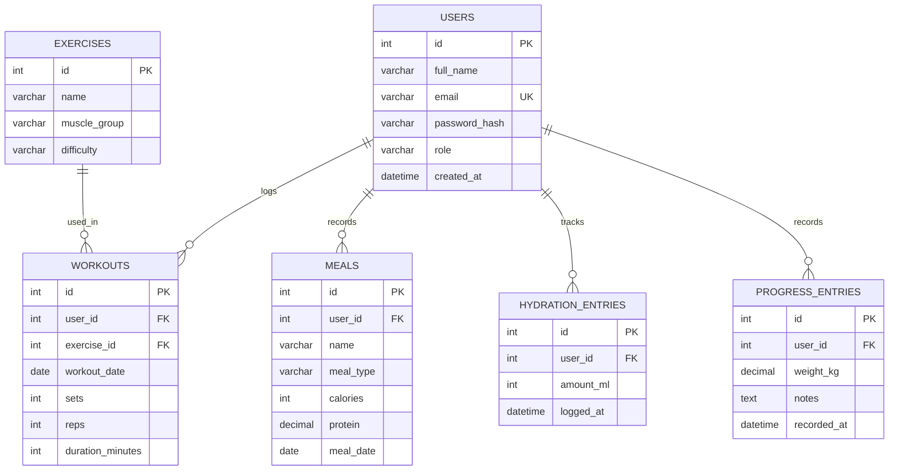

# FitTrack - Entity Relationship Diagram

## Database Overview

FitTrack uses a relational database with six main entities:
users, exercises, workouts, meals, hydration_entries,
and progress_entries.

## ER Diagram

## Relationships

1. One user can log multiple workouts.
2. One user can record multiple meals.
3. One user can track multiple hydration entries.
4. One user can record multiple progress entries.
5. One exercise can appear in multiple workout records.

## Primary Keys

Each entity has an `id` column as its primary key.

## Foreign Keys

- `workouts.user_id` references `users.id`
- `workouts.exercise_id` references `exercises.id`
- `meals.user_id` references `users.id`
- `hydration_entries.user_id` references `users.id`
- `progress_entries.user_id` references `users.id`

## Notes

This is the initial database design for Milestone 1.

The database will be implemented using MySQL in
Milestone 2. Foreign key constraints will ensure
referential integrity between related tables.
